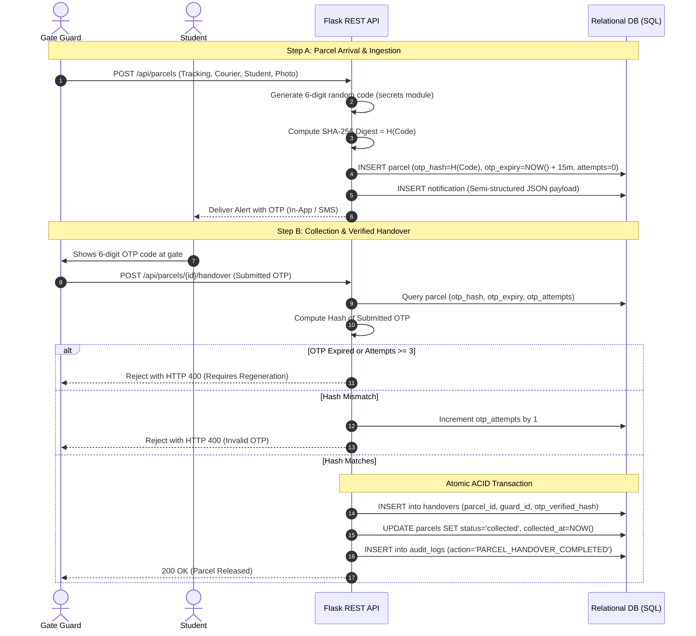

# ParcelDesk — Cloud Security Architecture & Controls

## 1. Role-Based Access Control (RBAC) Matrix

ParcelDesk implements least-privilege Role-Based Access Control enforcing role separation across Guard, Student, Warden, and Admin users:

| Feature / Resource | Gate Guard (`guard`) | Student (`student`) | Hostel Warden (`warden`) | System Admin (`admin`) |
| :--- | :---: | :---: | :---: | :---: |
| **Log Arriving Parcel** | ✅ | ❌ | ❌ | ✅ |
| **Upload Parcel Photo** | ✅ | ❌ | ❌ | ✅ |
| **View Own Deliveries** | ❌ | ✅ | ❌ | ✅ |
| **View Active OTP** | ❌ | ✅ | ❌ | ✅ |
| **Regenerate Own OTP** | ❌ | ✅ | ❌ | ✅ |
| **Verify OTP & Handover**| ✅ | ❌ | ❌ | ✅ |
| **View Pending Queue** | ✅ | ❌ | ✅ | ✅ |
| **Warden Analytics & KPIs**| ❌ | ❌ | ✅ | ✅ |
| **Export Power BI CSV** | ❌ | ❌ | ✅ | ✅ |
| **View Audit Trail** | ❌ | ❌ | ✅ | ✅ |

Middleware decorators [`@login_required`](file:///c:/Users/THARUN%20DEV/OneDrive/Documents/parceldesk-project/app.py) and [`@roles_required(...)`](file:///c:/Users/THARUN%20DEV/OneDrive/Documents/parceldesk-project/app.py) intercept every API invocation and return HTTP 401/403 for unauthorized requests.

---

## 2. Password Security & Cryptography
- **Hashing Algorithm**: Cryptographically salted PBKDF2 (SHA-256) or scrypt implemented via Werkzeug security primitives.
- **Salts**: Automatically generated per-user salt to thwart rainbow-table precomputations.
- **Verification**: Constant-time comparison preventing timing attacks.

---

## 3. Cryptographic OTP Handover Architecture

### Key Security Safeguards:
1. **Never Stored in Plaintext**: Only the 64-character SHA-256 hexadecimal digest is stored in the database.
2. **Short TTL (Time-To-Live)**: Codes automatically expire after 15 minutes.
3. **Brute-Force Counter**: Verification locks after 3 failed attempts (`otp_attempts >= 3`).
4. **Single-Use Invalidation**: Upon successful handover, `otp_hash` is wiped (`NULL`) and the parcel is marked `'collected'`.

---

## 4. Secret Management & Azure Key Vault
- **Zero Hardcoded Credentials**: API secrets, database connection strings, and storage keys are strictly isolated into environment variables (`.env`).
- **Production Integration**: In Azure App Service, configuration is sourced directly from **Azure Key Vault** using Managed Identities (System-Assigned Managed Identity), eliminating credential files from the deployment artifact.

---

## 5. SQL Injection & Cross-Site Scripting (XSS) Defenses
1. **100% Parameterized Queries**: All database queries use parameter substitution placeholders (`?` / `@Param`). String concatenation for SQL queries is forbidden.
2. **Input Validation**: Filenames uploaded for parcel photos are sanitized using `werkzeug.utils.secure_filename` with UUID prefixes to block directory traversal attacks (`../../evil.sh`).
3. **HTML Sanitization**: Client-side JavaScript passes all server-rendered strings through `escapeHtml()` to neutralize stored or reflected Cross-Site Scripting (XSS).
4. **Cookie Flags**: Session cookies are configured with `HttpOnly=True` and `SameSite=Lax`.

---

## 6. Audit Logging & Compliance Ledger
Every security-critical event is written to the immutable `audit_logs` table:
- `LOGIN_SUCCESS` / `LOGIN_FAILED`
- `PARCEL_LOGGED`
- `NOTIFICATION_SENT`
- `OTP_REGENERATED`
- `HANDOVER_FAILED_INVALID_OTP`
- `PARCEL_HANDOVER_COMPLETED`

Logs record the timestamp, operating user ID, security action, event detail payload, and client IP address (`X-Forwarded-For`).
