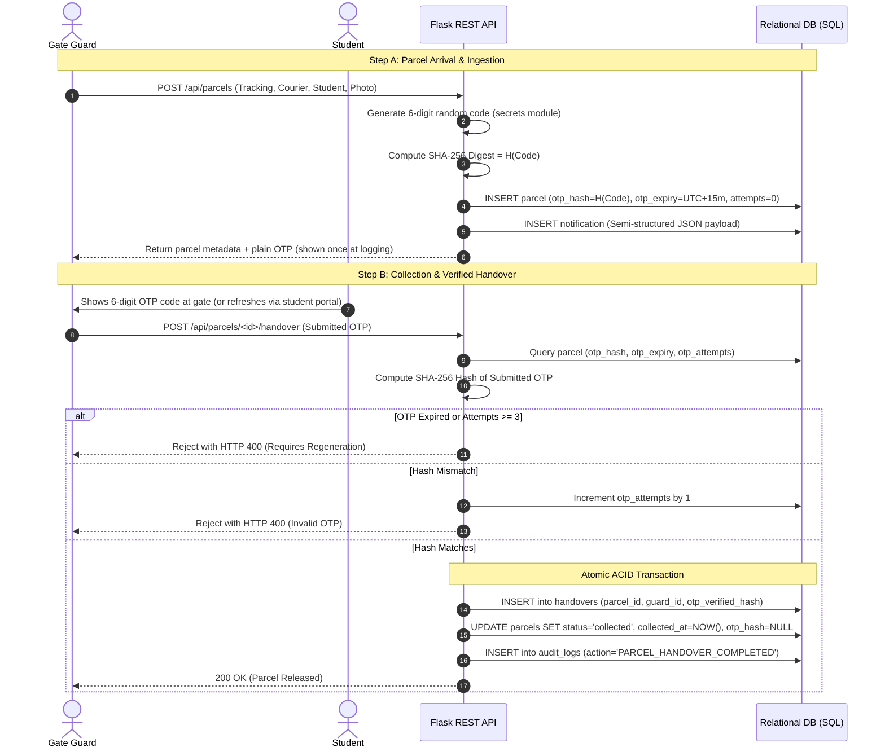

# ParcelDesk — Cloud Security Architecture & Controls

## 1. Role-Based Access Control (RBAC) Matrix

ParcelDesk enforces Role-Based Access Control across `guard`, `student`, `warden`, and `admin` roles using [`@login_required`](../app.py) and [`@roles_required(...)`](../app.py) in [`app.py`](../app.py):

| Feature / Endpoint | Gate Guard (`guard`) | Student (`student`) | Hostel Warden (`warden`) | System Admin (`admin`) |
| :--- | :---: | :---: | :---: | :---: |
| **Log Arriving Parcel & Upload Photo** (`POST /api/parcels`) | ✅ | ❌ | ❌ | ✅ |
| **View Own Deliveries & Notifications** (`GET /api/parcels`, `/api/notifications`) | ❌ *(sees all parcels)* | ✅ | ❌ *(sees all parcels)* | ❌ *(sees all parcels)* |
| **Regenerate Own OTP** (`POST /api/parcels/<id>/regenerate-otp`) | ❌ | ✅ | ❌ | ❌ *(403: student-only)* |
| **Verify OTP & Handover** (`POST /api/parcels/<id>/handover`) | ✅ | ❌ | ❌ | ✅ |
| **View Pending Queue** (`GET /api/parcels/pending`) | ✅ | ❌ | ✅ | ✅ |
| **Resend Notification** (`POST /api/parcels/<id>/notify`) | ✅ | ❌ | ✅ | ✅ |
| **Analytics KPIs** (`GET /api/analytics/summary`) | ✅ | ❌ | ✅ | ✅ |
| **Export Power BI CSV** (`GET /api/analytics/powerbi-export`) | ❌ | ❌ | ✅ | ✅ |
| **View Audit Trail** (`GET /api/audit-logs`) | ❌ | ❌ | ✅ | ✅ |
| **List Students** (`GET /api/students`) | ✅ | ✅ *(`@login_required`)* | ✅ | ✅ |

Unauthorized requests receive HTTP `401` or `403`. *(Note: restricting `GET /api/students` to staff roles is tracked under Known Limitations.)*

---

## 2. Password Security & Cryptography
- **Hashing Algorithm**: Cryptographically salted PBKDF2/scrypt implemented via Werkzeug (`generate_password_hash` / `check_password_hash`) in [`services/auth_service.py`](../services/auth_service.py).
- **Salts**: Automatically generated per-user salt to thwart rainbow-table precomputations.
- **Verification**: Constant-time comparison preventing timing attacks.

---

## 3. Cryptographic OTP Handover Architecture

### Key Security Safeguards:
1. **Hashed Storage Only in `parcels`**: Only SHA-256 hashed OTPs (`otp_hash`) are stored in the `parcels` table; the plain OTP is shown once at parcel logging (and when regenerated by the student).
2. **Short TTL (Time-To-Live)**: Codes automatically expire after 15 minutes (`OTP_EXPIRY_MINUTES=15`).
3. **Brute-Force Counter**: Verification stops after 3 failed attempts (`otp_attempts >= 3`).
4. **Single-Use Invalidation**: Upon successful handover, `otp_hash` is wiped (`NULL`) and the parcel is marked `'collected'`.

---

## 4. Secret Management & Environment Configuration
- **Secrets Stored in App Settings, Not Repository**: `SECRET_KEY`, `AZURE_SQL_CONNECTION_STRING`, and `AZURE_STORAGE_CONNECTION_STRING` are configured as **Azure App Service environment settings** in production and in a local `.env` file during development.
- **Excluded from Git**: `.env` is listed in `.gitignore` (verified with `git check-ignore .env`) so no secrets or connection strings are committed to the repository.

---

## 5. SQL Injection, XSS & Transport Defenses
1. **100% Parameterized Queries**: All database queries use parameter substitution placeholders (`?`) via [`database/db.py`](../database/db.py).
2. **Upload Sanitization**: Filenames uploaded for parcel photos are checked against an image extension allowlist (`png`, `jpg`, `jpeg`, `webp`, `gif`) and sanitized with `werkzeug.utils.secure_filename` plus a random UUID prefix.
3. **HTML Escaping**: Client-side JavaScript passes displayed text fields through `escapeHtml()` to mitigate Cross-Site Scripting (XSS).
4. **HTTPS & Cookie Flags**: Azure App Service enforces HTTPS Only (`httpsOnly: true`), and Flask session cookies use `HttpOnly=True` and `SameSite=Lax` in [`config.py`](../config.py).

---

## 6. Audit Logging & Compliance Ledger
Security-relevant events are written to the `audit_logs` table:
- `LOGIN_SUCCESS` / `LOGIN_FAILED` / `LOGOUT`
- `PARCEL_LOGGED`
- `NOTIFICATION_SENT`
- `OTP_REGENERATED`
- `HANDOVER_FAILED_INVALID_OTP`
- `PARCEL_HANDOVER_COMPLETED`
- `SYSTEM_INIT`

Logs record the timestamp, user ID (when available), security action, event details, and client IP address (`X-Forwarded-For`).
