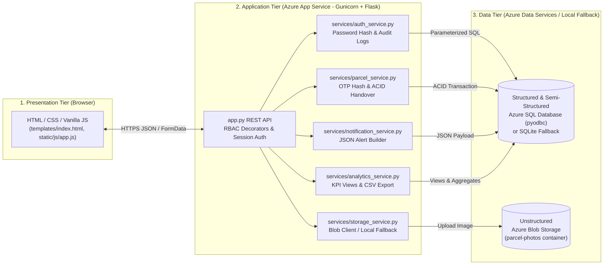
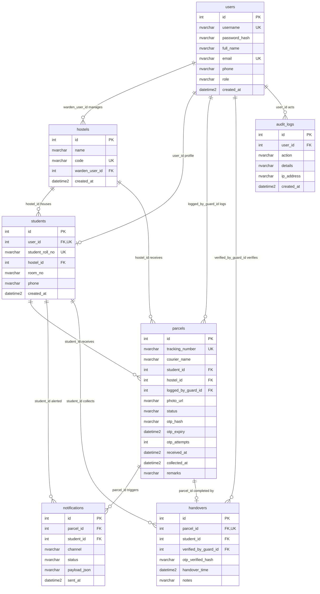

# ParcelDesk — Project Report

**Live Application:** [https://parceldesk-td-2026.azurewebsites.net](https://parceldesk-td-2026.azurewebsites.net)  
**Domain:** Logistics — Hostel Parcel Reception, Notification, and Verified Handover  
**Team Type:** Solo

---

## 1. Problem Statement & Target Users

### Problem Statement
In many college hostels, incoming courier deliveries are recorded manually in paper registers at the security gate. Students are unaware when parcels arrive unless they check the desk, packages are occasionally misplaced or handed to the wrong resident, and gate staff lack verifiable proof of who collected a parcel and when.

**ParcelDesk** digitizes the end-to-end hostel parcel lifecycle: logging arrival at the gate, issuing notification alerts with status tracking, and verifying physical pickup with a single-use one-time code (OTP).

### Target Users
| Role | System Role Value | Responsibilities in ParcelDesk |
| :--- | :--- | :--- |
| **Hostel Gate Staff / Guards** | `guard` | Log incoming parcels (recipient student, courier, tracking ID, condition photo, remarks), resend notifications, and verify student OTPs at handover. |
| **Students** | `student` | View incoming and past deliveries, inspect parcel condition photos, monitor status (`received` → `notified` → `collected`), view arrival notification JSON details, and reveal/refresh their 6-digit OTP. |
| **Hostel Wardens & Admins** | `warden`, `admin` | Monitor pending shelf backlog per hostel, track average pickup turnaround hours, export the Power BI CSV dataset, and inspect the security audit log. |

---

## 2. Functional & Non-Functional Requirements

### Functional Requirements
1. **FR-1 Role-Based Login:** Users authenticate via `/api/login` using hashed passwords and receive role-scoped access (`guard`, `student`, `warden`, `admin`).
2. **FR-2 Parcel Entry:** Gate staff log each arriving parcel with tracking number, courier name, student ID, hostel ID, optional condition photo, and remarks.
3. **FR-3 Notification & Status Tracking:** Logging a parcel generates a semi-structured JSON notification record in `notifications` and updates parcel status from `received` to `notified`; guards and wardens can re-trigger alerts via `/api/parcels/<id>/notify`.
4. **FR-4 Single-Use OTP Verification:** Each parcel receives a random 6-digit OTP stored as a SHA-256 hash with a 15-minute expiry and a maximum of 3 verification attempts. Students can regenerate expired/active OTPs on their own parcels.
5. **FR-5 Atomic Handover Ledger:** Guard verification executes inside a database transaction that checks OTP hash, expiry, and attempt limits, inserts a record into `handovers`, marks the parcel `collected` (also enforced by trigger), clears `otp_hash`, and records an audit event.
6. **FR-6 Reporting & Audit Visibility:** Wardens and admins view summary KPIs, pending counts by hostel, audit logs, and download a CSV dataset for Power BI.

### Non-Functional Requirements
1. **NFR-1 Data Integrity:** Normalized 3NF relational schema with foreign-key constraints, check constraints, unique tracking numbers, and atomic transactions.
2. **NFR-2 Transport & Credential Security:** HTTPS enforced on Azure App Service (`httpsOnly: true`), salted password hashes, SHA-256 OTP hashes, parameterized SQL queries, and secrets isolated in `.env` / Azure App Service settings.
3. **NFR-3 Portability & Resilience:** Automatic fallback to local SQLite (`database/parceldesk.db`) when `AZURE_SQL_CONNECTION_STRING` is empty, and local disk fallback (`static/uploads/`) when `AZURE_STORAGE_CONNECTION_STRING` is unset.
4. **NFR-4 Responsiveness:** Carbon + Signal Orange UI works across desktop (collapsible sidebar) and mobile drawer widths.

---

## 3. Architecture & Data Flow

ParcelDesk uses a **three-tier web architecture** hosted on Azure App Service (Linux, Python 3.11) backed by Azure SQL Database and Azure Blob Storage.

### End-to-End Parcel Lifecycle Flow
1. **Receive (`POST /api/parcels`):** Guard submits parcel details and optional photo. `StorageService` uploads the photo to Azure Blob Storage (or `static/uploads/` locally). `ParcelService` generates a 6-digit OTP, stores `SHA-256(otp)` + `otp_expiry` (+15 min), inserts into `parcels`, and calls `NotificationService`.
2. **Notify (`notifications` table):** `NotificationService` writes a structured JSON document into `notifications.payload_json` and updates `parcels.status` to `'notified'`.
3. **Refresh OTP (`POST /api/parcels/<id>/regenerate-otp`):** Student logs in, views parcel status timeline, and requests a fresh 6-digit OTP, resetting `otp_attempts` to `0` and `otp_expiry` to `+15` minutes.
4. **Verify & Handover (`POST /api/parcels/<id>/handover`):** Guard submits the 6-digit OTP. Inside `with get_db() as conn:`, `ParcelService` checks status, attempts `< 3`, expiry, and `SHA-256(submitted_otp) == otp_hash`. On success, it inserts into `handovers` (firing `trg_parcel_collected_after_handover`), updates `parcels` (`status = 'collected'`, `otp_hash = NULL`), and writes to `audit_logs`.

---

## 4. API List

Implemented in [`app.py`](../app.py):

| Method | Endpoint | Allowed Roles | Description |
| :--- | :--- | :--- | :--- |
| `GET` | `/` | Public | Serves the single-page web application (`templates/index.html`). |
| `POST` | `/api/login` | Public | Verifies username/password hash, starts session cookie, writes `LOGIN_SUCCESS`/`LOGIN_FAILED` audit log. |
| `POST` | `/api/logout` | Any | Clears session and writes `LOGOUT` audit log if user was logged in. |
| `GET` | `/api/me` | Public | Returns `{authenticated: true, user}` or `{authenticated: false}`. |
| `GET` | `/api/parcels` | Authenticated | Returns student's own parcels for `student`; all/filtered parcels (`status`, `hostel_id`) for `guard`, `warden`, `admin`. |
| `POST` | `/api/parcels` | `guard`, `admin` | Logs incoming parcel (multipart form or JSON), uploads photo, hashes OTP, creates JSON notification. |
| `GET` | `/api/parcels/pending` | `guard`, `warden`, `admin` | Queries `vw_pending_parcels` ordered by `received_at DESC`. |
| `POST` | `/api/parcels/<id>/notify` | `guard`, `warden`, `admin` | Re-creates and stores a notification JSON payload for the parcel. |
| `POST` | `/api/parcels/<id>/handover` | `guard`, `admin` | Verifies OTP hash/expiry/attempts and records handover in an atomic transaction. |
| `POST` | `/api/parcels/<id>/regenerate-otp` | `student` | Verifies parcel ownership and issues a new 6-digit hashed OTP with fresh 15-minute TTL. |
| `GET` | `/api/students` | Authenticated | Lists students with roll number, room, and hostel info for parcel entry dropdowns. |
| `GET` | `/api/hostels` | Public | Lists registered hostel blocks (`id`, `name`, `code`). |
| `GET` | `/api/notifications` | Authenticated | Returns parsed notification records for the signed-in `student` (empty list for other roles). |
| `GET` | `/api/analytics/summary` | `guard`, `warden`, `admin` | Returns KPI totals, average pickup hours, pending count per hostel, `vw_daily_parcel_volume`, and `vw_avg_pickup_time`. |
| `GET` | `/api/analytics/powerbi-export` | `warden`, `admin` | Downloads `parceldesk_powerbi_dataset.csv` with parcel metrics and duration hours. |
| `GET` | `/api/audit-logs` | `warden`, `admin` | Returns latest 100 entries from `audit_logs` joined with `users`. |

---

## 5. Key Architectural Trade-Off

### Hashing Short-Lived OTPs vs. Storing Plaintext Codes
- **Decision:** Generate a random 6-digit OTP using Python's `secrets` module, store only its **SHA-256 hash** (`otp_hash`) with a **15-minute expiry** (`otp_expiry`) and a **3-attempt limit** (`otp_attempts`), and set `otp_hash = NULL` immediately upon handover.
- **Cost:** Adds a SHA-256 computation during creation and verification and requires students to tap **Reveal / Refresh OTP** if the 15-minute window expires before reaching the gate.
- **Benefit:** If the database, backups, or read-only reporting views are ever exposed, attackers cannot read valid pickup codes to impersonate students and claim parcels.

---

## 6. Entity-Relationship Diagram

Defined identically across [`database/azure_sql_schema.sql`](../database/azure_sql_schema.sql) and [`database/sqlite_schema.sql`](../database/sqlite_schema.sql):

---

## 7. Third Normal Form (3NF) Explanation

1. **First Normal Form (1NF):** Every table has a surrogate primary key (`id`), atomic scalar columns, and no repeating column groups. (Notification payloads are stored as a single JSON string attribute for semi-structured event logs.)
2. **Second Normal Form (2NF):** Every table uses a single-column primary key (`id`), so partial dependencies on a composite key cannot occur; all non-key attributes depend on the full primary key.
3. **Third Normal Form (3NF):** Transitive dependencies are separated into dedicated tables:
   - User identity and credentials live in `users`; student-specific fields (`student_roll_no`, `room_no`, `hostel_id`) are isolated in `students` instead of being repeated per user or per parcel.
   - Hostel metadata (`name`, `code`, `warden_user_id`) lives in `hostels` rather than on every `students` or `parcels` row.
   - Handover verification details (`verified_by_guard_id`, `otp_verified_hash`, `handover_time`, `notes`) reside in `handovers` (1:1 with `parcels` via `UNIQUE(parcel_id)`), separating physical release proof from parcel receipt attributes.

---

## 8. Data Classification (DP-900 / Azure Data Services)

| Data Category | Azure / Local Service | Stored Artifacts |
| :--- | :--- | :--- |
| **Structured Data** | **Azure SQL Database** (`parceldesk-td/parceldesk-db`) via `pyodbc` (falls back to SQLite locally) | Relational tables (`users`, `hostels`, `students`, `parcels`, `notifications`, `handovers`, `audit_logs`), foreign/check constraints, indexes, trigger (`trg_parcel_collected_after_handover`), and views (`vw_pending_parcels`, `vw_daily_parcel_volume`, `vw_avg_pickup_time`). |
| **Semi-Structured Data** | **JSON Documents in SQL** (`notifications.payload_json`) | Variable event payloads generated by `NotificationService` containing nested `recipient` objects, `channels` arrays, `event` types, and timestamps without rigid column expansion. |
| **Unstructured Data** | **Azure Blob Storage** (`parceldeskstore26` / private container `parcel-photos`, falls back to `static/uploads/`) | Binary parcel condition images (`.png`, `.jpg`, `.jpeg`, `.webp`, `.gif`) uploaded by gate staff during parcel registration. |

---

## 9. One-Page Threat Model

### Scope, Assets & Trust Boundaries
- **Critical Assets:** Student parcel physical custody, OTP hashes/codes, user passwords & Flask session cookies, Azure SQL & Storage connection strings, and audit logs.
- **Trust Boundaries:**
  1. **Public Internet → Azure App Service (TLS):** Unauthenticated vs. authenticated browser requests.
  2. **App Service → Azure SQL Database:** Parameterized ODBC queries over TLS (`Encrypt=yes`) across Azure firewall boundary.
  3. **App Service → Azure Blob Storage:** Authenticated storage connection over HTTPS into private `parcel-photos` container.

### Threat Analysis (STRIDE Summary)

| Threat Category | Threat Scenario | Current Mitigation in Code | Residual Risk / Next Step |
| :--- | :--- | :--- | :--- |
| **Spoofing** | Attacker guesses a student's OTP or password to claim a parcel or log in. | Salted PBKDF2/scrypt password hashes; `secrets`-generated 6-digit OTPs stored as SHA-256 hashes; 15-min TTL; locked after 3 wrong OTP attempts (`otp_attempts >= 3`). | `/api/login` lacks per-IP login rate limiting; demo auto-login runs on UI load for testing convenience. |
| **Tampering** | SQL injection alters parcel status or handover records; malicious filename overwrites disk files. | 100% parameterized `?` queries in `database/db.py`; `secure_filename()` + UUID prefix + extension allowlist in `StorageService`; ACID transaction for handover. | No CSRF token on POST endpoints (`SameSite=Lax` mitigates cross-site form posts only partially); no `MAX_CONTENT_LENGTH` upload cap. |
| **Repudiation** | Guard or student denies logging, viewing, or handing over a parcel. | `audit_logs` records `LOGIN_SUCCESS`, `LOGIN_FAILED`, `PARCEL_LOGGED`, `NOTIFICATION_SENT`, `OTP_REGENERATED`, `HANDOVER_FAILED_INVALID_OTP`, and `PARCEL_HANDOVER_COMPLETED` with user ID, IP, and timestamp. | System-triggered `NOTIFICATION_SENT` / `OTP_REGENERATED` logs currently pass `user_id=None`. |
| **Information Disclosure** | Plaintext OTPs, secrets, or cross-student parcel data leaked. | Only SHA-256 `otp_hash` stored in DB; `.env` is git-ignored; secrets stored in App Service settings; `GET /api/parcels` scopes `student` role to `student_id`; `escapeHtml()` in `app.js` prevents DOM XSS; `SESSION_COOKIE_HTTPONLY = True`. | `SESSION_COOKIE_SECURE` is not explicitly set in `config.py`; private blob URLs need SAS tokens or a backend proxy route to render `` tags when uploaded to private `parcel-photos`. |
| **Denial of Service** | Repeated large photo uploads or brute-force requests exhaust App Service F1 resources. | OTP verification stops after 3 failed attempts. | No global HTTP rate limiter or Flask `MAX_CONTENT_LENGTH` request size limit configured yet. |
| **Elevation of Privilege** | Student accesses guard handover or warden audit endpoints. | `@login_required` and `@roles_required(...)` decorators check `session["user"]["role"]` and return `401`/`403`. | Keep demo persona switcher disabled/removed before real campus production rollout. |

---

## 10. Security Checklist (Based on Actual Code)

| Security Control | Status | Evidence in Code / Azure Configuration |
| :--- | :---: | :--- |
| Password hashing with per-user salt | **Done** | `generate_password_hash` / `check_password_hash` in `services/auth_service.py`. |
| Role-based access control (`guard`, `student`, `warden`, `admin`) | **Done** | `@login_required` & `@roles_required` in `app.py`; student queries scoped by `student_id`. |
| Hashed, single-use, short-lived OTPs with attempt limit | **Done** | SHA-256 `otp_hash`, `OTP_EXPIRY_MINUTES=15`, `MAX_OTP_ATTEMPTS=3`, cleared to `NULL` on handover (`services/parcel_service.py`). |
| Parameterized SQL queries (SQL injection protection) | **Done** | `?` placeholders used across `database/db.py`, `app.py`, and `services/*`. |
| XSS escaping in frontend rendering | **Done** | `escapeHtml()` used across table/card rendering in `static/js/app.js`. |
| Secrets excluded from Git repository | **Done** | `.env` listed in `.gitignore`, verified via `git check-ignore .env`; App Service stores settings in environment variables. |
| HTTPS enforced in production | **Done** | `httpsOnly: true` enabled on `parceldesk-td-2026.azurewebsites.net` (301 redirect from HTTP). |
| `HttpOnly` & `SameSite=Lax` session cookies | **Done** | Configured in `config.py` (`SESSION_COOKIE_HTTPONLY = True`, `SESSION_COOKIE_SAMESITE = "Lax"`). |
| Audit logging for auth, parcel entry, and handover | **Done** | `audit_logs` table populated via `AuthService.log_audit()` and handover transaction. |
| Upload extension whitelist & filename sanitization | **Done** | `ALLOWED_EXTENSIONS` and `secure_filename()` + UUID prefix in `services/storage_service.py`. |
| Private Azure Blob container (`publicAccess: null`) | **Done** | `parceldeskstore26` created with `--allow-blob-public-access false` and private `parcel-photos`. |
| Azure Key Vault integration for secrets | **Not done** | App settings are stored directly in Azure App Service configuration rather than Key Vault references. |
| Explicit `SESSION_COOKIE_SECURE = True` flag in Flask | **Not done** | Omitted in `config.py` so local HTTP dev (`127.0.0.1:5000`) continues working. |
| CSRF protection tokens on state-changing routes | **Not done** | No CSRF token validation middleware (relies on `SameSite=Lax` cookies). |
| Upload size cap (`MAX_CONTENT_LENGTH`) & MIME magic-byte check | **Not done** | Only filename extension is validated in `services/storage_service.py`. |
| HTTP login rate limiting | **Not done** | Failed logins are audited (`LOGIN_FAILED`), but `/api/login` is not rate-limited. |
| Authenticated proxy / SAS URL generation for private Blob images | **Not done** | `StorageService` returns raw `blob_client.url`; browser `` rendering of private blobs requires SAS or proxy route. |
| Standalone Power BI `.pbix` report file | **Not done** | SQL views and `/api/analytics/powerbi-export` CSV endpoint are implemented; `.pbix` file is not created. |

---

## 11. Screenshots

> Replace the placeholders below with captured screenshots before final submission.

1. **Gate Staff Console (Parcel Entry & Pending Queue)**  
   ``
2. **OTP Handover Verification Modal & Confirmed Collection**  
   ``
3. **Student Delivery Portal (Timeline & Collection Passcode)**  
   ``
4. **Warden Analytics Dashboard & Security Audit Log**  
   ``
5. **Azure Portal Resources (App Service, Azure SQL, Blob Storage)**  
   ``

---

## 12. Credits

- **Author:** Solo College Project (`ParcelDesk`)
- **AI Tools Used:**
  - **Antigravity** — assisted with project scaffolding, Carbon + Signal Orange UI/UX redesign, Azure SQL (`pyodbc`) integration, T-SQL query scripting, Azure App Service deployment, and documentation.
  - **Claude** — assisted with planning, design refinement, and review.
