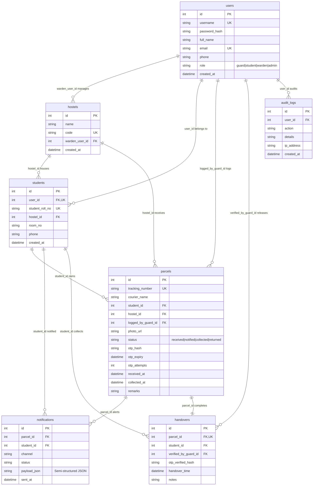

# ParcelDesk — RDBMS Database Design (3NF)

## 1. Relational Database Management System Overview
The ParcelDesk database is modeled in **Third Normal Form (3NF)** to eliminate redundancy, avoid update anomalies, and enforce relational integrity across university hostel parcel workflows.

---

## 2. Entity-Relationship Diagram (ERD)



---

## 3. Schema Normalization (3NF Justification)

1. **1NF (Atomic Attributes)**: Every column stores atomic values (no multivalued or composite attributes; JSON notification payloads are intentionally isolated for semi-structured log tracking).
2. **2NF (No Partial Functional Dependencies)**: All non-key attributes are fully functionally dependent on the entire primary key (all tables use single-column integer identity/autoincrement primary keys).
3. **3NF (No Transitive Functional Dependencies)**: Non-key attributes depend *only* on the candidate keys. For instance, room numbers and hostel allocations are attached to the `students` entity rather than duplicated on each `parcels` row.

---

## 4. ACID Transaction Handover Logic

The handover process represents the critical business transition from *holding* to *collected*. To maintain relational consistency, the verification, status update, and proof record insertion execute inside a single atomic transaction:

```sql
BEGIN TRANSACTION;

-- Step 1: Query parcel state & verify active status and TTL
SELECT id, student_id, status, otp_hash, otp_expiry, otp_attempts
FROM parcels WHERE id = @ParcelId;

-- Step 2: Validate OTP hash (SHA-256 match) & attempt limit (< 3)
-- (If invalid: UPDATE parcels SET otp_attempts = otp_attempts + 1; ROLLBACK;)

-- Step 3: Insert Handover Proof into ledger
INSERT INTO handovers (parcel_id, student_id, verified_by_guard_id, otp_verified_hash, handover_time, notes)
VALUES (@ParcelId, @StudentId, @GuardUserId, @SubmittedHash, CURRENT_TIMESTAMP, @Notes);

-- Step 4: Transition parcel status to collected
UPDATE parcels 
SET status = 'collected', collected_at = CURRENT_TIMESTAMP, otp_hash = NULL 
WHERE id = @ParcelId;

-- Step 5: Write Security Audit
INSERT INTO audit_logs (user_id, action, details, ip_address, created_at)
VALUES (@GuardUserId, 'PARCEL_HANDOVER_COMPLETED', @AuditDetails, @ClientIP, CURRENT_TIMESTAMP);

COMMIT TRANSACTION;
```

---

## 5. Database Views (Reporting & Analytics)

### View 1: `vw_pending_parcels`
Provides gate guards and wardens with a live, real-time query of packages awaiting pickup, joined with student contact numbers, hostel rooms, and elapsed wait time:
```sql
CREATE VIEW vw_pending_parcels AS
SELECT 
    p.id AS parcel_id,
    p.tracking_number,
    p.courier_name,
    p.photo_url,
    p.status,
    p.received_at,
    h.id AS hostel_id,
    h.name AS hostel_name,
    h.code AS hostel_code,
    s.id AS student_id,
    u.full_name AS student_name,
    s.student_roll_no,
    s.room_no,
    s.phone AS student_phone,
    g.full_name AS logged_by_guard,
    ROUND((JULIANDAY('now') - JULIANDAY(p.received_at)) * 24, 1) AS hours_waiting
FROM parcels p
JOIN students s ON p.student_id = s.id
JOIN users u ON s.user_id = u.id
JOIN hostels h ON p.hostel_id = h.id
JOIN users g ON p.logged_by_guard_id = g.id
WHERE p.status IN ('received', 'notified');
```

### View 2: `vw_daily_parcel_volume`
Aggregates incoming parcel throughput by date and hostel for logistics capacity planning:
```sql
CREATE VIEW vw_daily_parcel_volume AS
SELECT 
    DATE(p.received_at) AS log_date,
    h.name AS hostel_name,
    COUNT(p.id) AS total_parcels,
    SUM(CASE WHEN p.status = 'collected' THEN 1 ELSE 0 END) AS collected_parcels,
    SUM(CASE WHEN p.status IN ('received', 'notified') THEN 1 ELSE 0 END) AS pending_parcels
FROM parcels p
JOIN hostels h ON p.hostel_id = h.id
GROUP BY DATE(p.received_at), h.name;
```

### View 3: `vw_avg_pickup_time`
Calculates average student pickup turnaround time (hours) by hostel:
```sql
CREATE VIEW vw_avg_pickup_time AS
SELECT 
    h.name AS hostel_name,
    COUNT(p.id) AS completed_handovers,
    ROUND(AVG((JULIANDAY(p.collected_at) - JULIANDAY(p.received_at)) * 24), 2) AS avg_pickup_hours
FROM parcels p
JOIN hostels h ON p.hostel_id = h.id
WHERE p.status = 'collected' AND p.collected_at IS NOT NULL
GROUP BY h.name;
```

---

## 6. Indexing & Optimization Strategy

1. **`idx_parcels_student_id`**: Accelerates student dashboard lookups (`SELECT * FROM parcels WHERE student_id = ?`).
2. **`idx_parcels_status`**: Accelerates pending parcels queries (`WHERE status IN ('received', 'notified')`).
3. **`idx_parcels_tracking`**: Guarantees fast $O(\log n)$ barcode scanner searches by courier tracking number.
4. **`idx_notifications_parcel`**: Enables rapid retrieval of notifications linked to specific parcels.
5. **`idx_handovers_parcel`**: Ensures instantaneous verification of whether a parcel has prior collection records.
