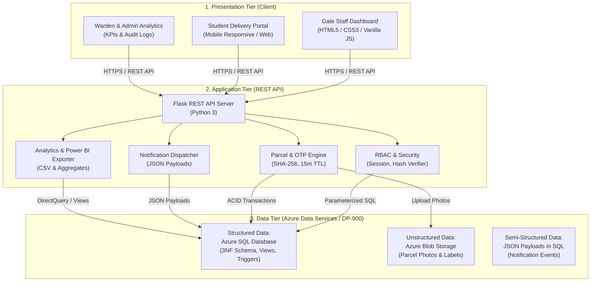

# ParcelDesk — System Design Specification

## 1. Overview & Problem Definition
**ParcelDesk** is a smart hostel logistics management system that digitizes the entire lifecycle of incoming courier packages at university and residential hostels:
- **Paper Register Elimination**: Replaces insecure, slow manual entry ledgers at the hostel gate.
- **Real-Time Notification**: Automatically alerts students as soon as their package is logged by gate staff.
- **Verified Handover via Single-Use OTP**: Prevents wrongful pickups or lost parcels using a cryptographically hashed one-time code.

---

## 2. Three-Tier Architecture

---

## 3. Core API Endpoints

Implemented in [`app.py`](../app.py):

| Method | Endpoint | Access Role | Description |
| :--- | :--- | :--- | :--- |
| `GET` | `/` | Public | Serves the single-page web portal (`templates/index.html`) |
| `POST` | `/api/login` | Public | Authenticates credentials, creates session, logs audit trail |
| `POST` | `/api/logout` | Any | Destroys current session and logs logout event if signed in |
| `GET` | `/api/me` | Public | Retrieves authentication status and current user profile |
| `GET` | `/api/parcels` | Authenticated (`student` scoped to own; `guard`, `warden`, `admin` all) | Lists parcels (filtered by student ownership or query params) |
| `POST` | `/api/parcels` | `guard`, `admin` | Logs incoming parcel, uploads photo, hashes OTP (shows plain OTP once), stores JSON notification |
| `GET` | `/api/parcels/pending` | `guard`, `warden`, `admin` | Queries `vw_pending_parcels` view for parcels awaiting collection |
| `POST` | `/api/parcels/<id>/notify` | `guard`, `warden`, `admin` | Dispatches notification with semi-structured JSON payload |
| `POST` | `/api/parcels/<id>/handover` | `guard`, `admin` | Executes atomic ACID transaction to verify OTP and hand over parcel |
| `POST` | `/api/parcels/<id>/regenerate-otp` | `student` | Verifies parcel ownership and generates a fresh 6-digit hashed OTP with 15-min expiry |
| `GET` | `/api/students` | Authenticated (`@login_required`) | Lists students for search and gate logging dropdown |
| `GET` | `/api/hostels` | Public | Lists registered hostel blocks |
| `GET` | `/api/notifications` | Authenticated (`student` gets own; other roles receive `[]`) | Returns parsed notification records for the signed-in student |
| `GET` | `/api/analytics/summary` | `guard`, `warden`, `admin` | Aggregates daily volume, pending per hostel, and avg turnaround |
| `GET` | `/api/analytics/powerbi-export` | `warden`, `admin` | Generates flat CSV dataset for Power BI ingestion |
| `GET` | `/api/audit-logs` | `warden`, `admin` | Streams latest 100 security and access audit logs |

---

## 4. Requirements Specification

### 4.1 Functional Requirements (FR)
1. **FR-1: Parcel Ingestion**: Gate staff must be able to log courier packages with student roll number, hostel block, courier name, tracking number, package photo, and remarks.
2. **FR-2: Dynamic Notification**: System must generate a delivery alert containing details of the parcel and collection instructions immediately upon gate entry.
3. **FR-3: Secure Single-Use OTP**: Recipient students receive a 6-digit verification code that expires in 15 minutes; only SHA-256 hashed OTPs are stored in the `parcels` table, and the plain OTP is shown once at parcel logging (or when regenerated by the student).
4. **FR-4: Verified Collection**: Parcels may only be released when the gate guard inputs the matching OTP; collection time and guard ID must be permanently recorded.
5. **FR-5: Audit Trail**: Every authentication, parcel ingestion, OTP regeneration, and handover must be written to an audit ledger.

### 4.2 Non-Functional Requirements (NFR)
1. **NFR-1: Security**: Only salted password hashes in `users` and SHA-256 hashed OTPs in `parcels` (`otp_hash`) are stored in the database; the plain OTP is shown once at parcel logging (never saved in `parcels`).
2. **NFR-2: Consistency & Integrity**: Handover operations must execute within an ACID transaction so that parcel status cannot change without an accompanying handover record.
3. **NFR-3: Availability & Scalability**: Relational queries must use indexed foreign keys and status flags to support multi-hostel campuses.
4. **NFR-4: Cloud Native**: Deployed on Azure App Service with Azure SQL Database and Azure Blob Storage, with SQLite and local disk fallbacks for offline development.

---

## 5. Architectural Trade-off Analysis: Hashed OTP vs. Plaintext Storage

| Dimension | Option A: Plaintext OTP Storage | Option B: Hashed OTP with Short TTL (ParcelDesk Choice) |
| :--- | :--- | :--- |
| **Security against DB Leak** | ❌ **High Risk**: An exposed database dump or insider threat reveals all active collection codes. | ✅ **Zero Leakage in `parcels`**: Only SHA-256 hashed OTPs are stored in the `parcels` table; the plain OTP is shown once at parcel logging and cannot be reconstructed from `otp_hash`. |
| **Replay / Shoulder Surfing**| ❌ Codes valid indefinitely unless actively purged. | ✅ **15-Minute Expiry & Max 3 Attempts**: Minimizes brute-force and shoulder-surfing attack windows. |
| **Computational Overhead** | ✅ Negligible (simple string comparison). | ⚠️ Minor: Server performs SHA-256 hash calculation per verification attempt (sub-millisecond in Python). |
| **Decision Rationale** | *Rejected* due to severe physical security vulnerabilities in a hostel environment. | **Adopted**: The sub-millisecond hash verification overhead is vastly outweighed by the elimination of credential leaks. |
