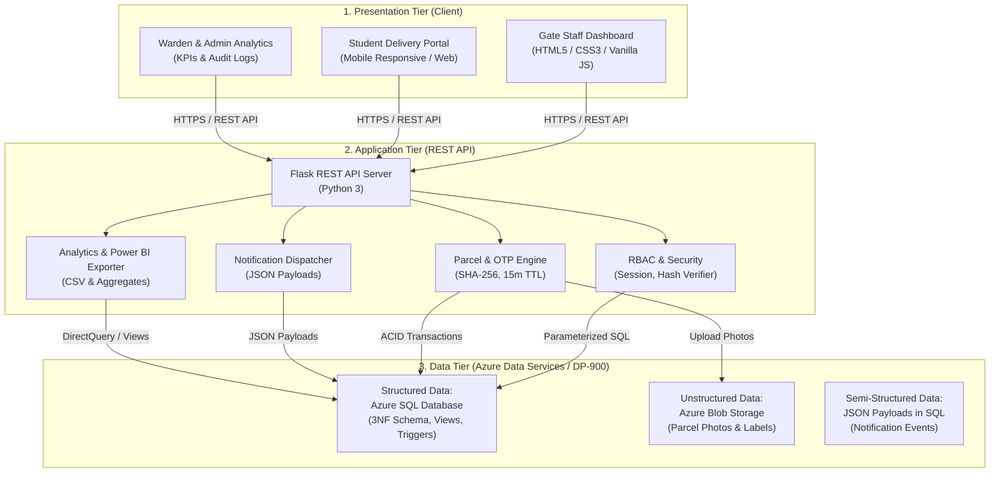

# ParcelDesk — System Design Specification

## 1. Overview & Problem Definition
**ParcelDesk** is a smart hostel logistics management system that digitizes the entire lifecycle of incoming courier packages at university and residential hostels:
- **Paper Register Elimination**: Replaces insecure, slow manual entry ledgers at the hostel gate.
- **Real-Time Notification**: Automatically alerts students as soon as their package is logged by gate staff.
- **Verified Handover via Single-Use OTP**: Prevents wrongful pickups or lost parcels using a cryptographically hashed one-time code.

---

## 2. Three-Tier Architecture

---

## 3. Core API Endpoints

| Method | Endpoint | Access Role | Description |
| :--- | :--- | :--- | :--- |
| `POST` | `/api/login` | Public | Authenticates credentials, creates session, logs audit trail |
| `POST` | `/api/logout` | Authenticated | Destroys current session and logs logout event |
| `GET` | `/api/me` | Authenticated | Retrieves current authenticated profile & student context |
| `GET` | `/api/parcels` | All Roles | Lists parcels (filtered by student ownership or hostel) |
| `POST` | `/api/parcels` | `guard`, `admin` | Logs incoming parcel, uploads photo, generates OTP, triggers notification |
| `GET` | `/api/parcels/pending` | `guard`, `warden` | Queries `vw_pending_parcels` view for parcels awaiting collection |
| `POST` | `/api/parcels/{id}/notify`| `guard`, `warden` | Dispatches notification with semi-structured JSON payload |
| `POST` | `/api/parcels/{id}/handover`| `guard`, `admin` | Executes atomic ACID transaction to verify OTP and hand over parcel |
| `POST` | `/api/parcels/{id}/regenerate-otp`| `student` | Generates a fresh 6-digit OTP with new 15-min expiry timestamp |
| `GET` | `/api/students` | Authenticated | Autocomplete and lookup endpoint for gate logging form |
| `GET` | `/api/analytics/summary` | `warden`, `admin` | Aggregates daily volume, pending per hostel, and avg turnaround |
| `GET` | `/api/analytics/powerbi-export`| `warden`, `admin` | Generates flat CSV dataset for Power BI ingestion |
| `GET` | `/api/audit-logs` | `warden`, `admin` | Streams security and access audit logs |

---

## 4. Requirements Specification

### 4.1 Functional Requirements (FR)
1. **FR-1: Parcel Ingestion**: Gate staff must be able to log courier packages with student roll number, hostel block, courier name, tracking number, package photo, and remarks.
2. **FR-2: Dynamic Notification**: System must generate a delivery alert containing details of the parcel and collection instructions immediately upon gate entry.
3. **FR-3: Secure Single-Use OTP**: Recipient students must receive a 6-digit verification code that expires in 15 minutes.
4. **FR-4: Verified Collection**: Parcels may only be released when the gate guard inputs the matching OTP; collection time and guard ID must be permanently recorded.
5. **FR-5: Audit Trail**: Every authentication, parcel ingestion, OTP regeneration, and handover must be written to an immutable audit ledger.

### 4.2 Non-Functional Requirements (NFR)
1. **NFR-1: Security**: No plaintext passwords or OTPs stored in database. Passwords use PBKDF2/scrypt; OTPs use SHA-256.
2. **NFR-2: Consistency & Integrity**: Handover operations must execute within an ACID transaction so that parcel status cannot change without an accompanying handover record.
3. **NFR-3: Availability & Scalability**: Relational queries must use indexed foreign keys and status flags to support multi-hostel campuses.
4. **NFR-4: Cloud Native**: Ready for deployment on Azure App Service with Azure SQL Database and Azure Blob Storage.

---

## 5. Architectural Trade-off Analysis: Hashed OTP vs. Plaintext Storage

| Dimension | Option A: Plaintext OTP Storage | Option B: Hashed OTP with Short TTL (ParcelDesk Choice) |
| :--- | :--- | :--- |
| **Security against DB Leak** | ❌ **High Risk**: An exposed database dump or insider threat reveals all active collection codes. | ✅ **Zero Leakage**: Attackers see only irreversible SHA-256 digests; OTP cannot be reconstructed. |
| **Replay / Shoulder Surfing**| ❌ Codes valid indefinitely unless actively purged. | ✅ **15-Minute Expiry & Max 3 Attempts**: Minimizes brute-force and shoulder-surfing attack windows. |
| **Computational Overhead** | ✅ Negligible (simple string comparison). | ⚠️ Minor: Server performs SHA-256 hash calculation per verification attempt (sub-millisecond in Python). |
| **Decision Rationale** | *Rejected* due to severe physical security vulnerabilities in a hostel environment. | **Adopted**: The sub-millisecond hash verification overhead is vastly outweighed by the elimination of credential leaks. |
